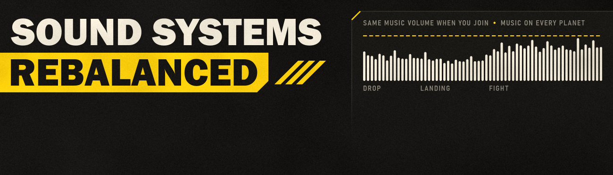

# Sound Systems Rebalanced v1.0

Fixes for broken audio in Helldivers 2. This first version fixes two mission music bugs:

- Every mission plays its music at the same volume: the volume you hear after deploying from the war table. In the
  base game the music was 6 dB louder when you deployed from anywhere else on the Super Destroyer, most often when
  joining a squad's mission already in progress.
- Mission music no longer goes silent on planets the music has no version for (swamp, deciduous and coniferous
  forest, desert, oasis, hive worlds, active rifts). In the base game the calm music after landing stayed silent
  there for minutes, until the fighting changed the music.

**Status:** pre-release. Both causes were measured live in missions (a 6.00 dB step on the music bus; about 150 s of
silent music on a swamp planet against music on a grassland planet). Both fixes are tested offline and live in solo
missions: with the mod, a swamp planet plays its full drop music and its calm music from 46 s after landing, and a
grassland planet sounds as before. A real two-player join is not tested yet. See
[docs/TECHNICAL.md](docs/TECHNICAL.md).

Before this release the mod was developed as Mission Music Fix; that version was never released.

## What changes

The Super Destroyer's rooms tell the game's audio engine which room you are in, so the ship can sound different
in each. The war-table area at the big window also turns the music down by 6 dB. The game never resets that room
when you leave the ship, so a mission inherited it:

- Deploy from the war table (solo, as host, or gathered there with your squad): mission music 6 dB lower.
- Deploy from the armory, hangar or deck, which is where most players are when they accept a join into a mission
  in progress: mission music 6 dB higher, from the descent to the score screen.

The mod sets the war-table room whenever a mission starts, so every mission uses the volume most players know.
Missions you start from the war table sound exactly as before. In missions that room setting affects only the
music. Back on the ship, the ship's own rooms take over again as you walk between them, as they do in the base
game after a mission started from the war table.

If you lowered your Music Volume for joined missions, you can set it back.

### Silent music on some planets

The mission music comes in versions for five kinds of planet, chosen by the planet's biome. The game has 14
biomes, and seven of them have no version: swamp, deciduous forest, coniferous forest, desert, oasis, hive world
and active rift. On those planets the calm music that should start 40-50 s after landing plays nothing, and the
drop music is cut short, until the fighting changes the music. This matches the reports of music that stops for
2-3 minutes.

The mod gives those seven biomes the music's own default version, the one grassland and forest planets play.
It is a sound-bank change only: nothing runs while you play, and every other sound, the planet's ambience
included, is untouched.

## Requirements and install

- Helldivers 2 Steam build **25480438** (EXE 1.8.46015.0). The volume fix checks the EXE and game.dll hashes
  and does nothing on any other build. The silent-music fix is a copy of the game's `music_init` sound bank and
  cannot switch itself off: after a game update, disable the mod until a matching version is out.
- [Bingus Shared Loader v18 or newer](https://github.com/CowboyBingus/BingusSharedLoader/releases/latest).

Import the release ZIP into Arsenal or HD2MM together with the loader, enable and deploy both, then restart the
game. The log is `%LOCALAPPDATA%\CowboyBingus\Helldivers2\Logs\SoundSystemsRebalanced.log`: one line per mission
start.

## Multiplayer

Music is local to each player. The mod changes only your own game, needs nothing from other players and sends
nothing.

## Cost

- Most frames: no memory read and no system call.
- Every 0.25 s of game time: one 4-byte memory read of the game state.
- Once per mission start: one call to the engine's own Wwise state function and one log line.
- The silent-music fix runs no code: the music bank it replaces is 33 KB larger (520 KB instead of 487 KB).
- Nothing is written to game memory. Measured in the game on the ship: 0.005 ms per frame; real play is not
  measured yet.

## Other mods

A mod that also replaces `music_init` cannot be used with this one; the one deployed later wins. Music
replacement mods replace the mission music banks, which this mod leaves untouched.

## Build and test

Clone [Bingus Shared Loader](https://github.com/CowboyBingus/BingusSharedLoader) beside this repository (or set
`BINGUS_SHARED_LOADER` to its path). The tests need LuaJIT (`HD2_LUAJIT`, or `luajit` on `PATH`) and the installed
game's `bin/lua51.dll` (set `HD2_LUA51_DLL` if the game is not in the default Steam folder).

The silent-music fix is built from the game's own music banks. This repository contains no game files: extract the
five unmodified banks from your Steam build 25480438 installation into `build/vanilla-banks/` (or set
`HD2_MUSIC_BANKS` to another folder), for example with `hd2-resource-extract` from
[Better Stratagem Bounce](https://github.com/CowboyBingus/BetterStratagemBounce):

```
hd2-resource-extract -type wwise_bank -name content/audio/music_init -out build/vanilla-banks/music_init.wwise_bank
```

and the same for `music_mission_bot`, `music_mission_bug`, `music_mission_bug_hiveworld` and
`music_mission_illuminate`. The build checks each file's SHA-256 and refuses any other game version.

```
python scripts/build.py
```

It runs the tests in LuaJIT and in the game's own `lua51.dll` (the game is never started), checks that the
vendored [Bingus Shared Runtime](https://github.com/CowboyBingus/BingusSharedRuntime) files are byte-identical to
the canonical ones when the workspace has them, runs the sound-bank tests (`tests/test_biome_patch.py`), and writes
`releases/Sound-Systems-Rebalanced-v1.0.zip`.

## License

Zero-Clause BSD (0BSD), see `LICENSE`.

**AI disclosure:** Claude Opus 5.5 assisted with research, implementation, tests and documentation.
